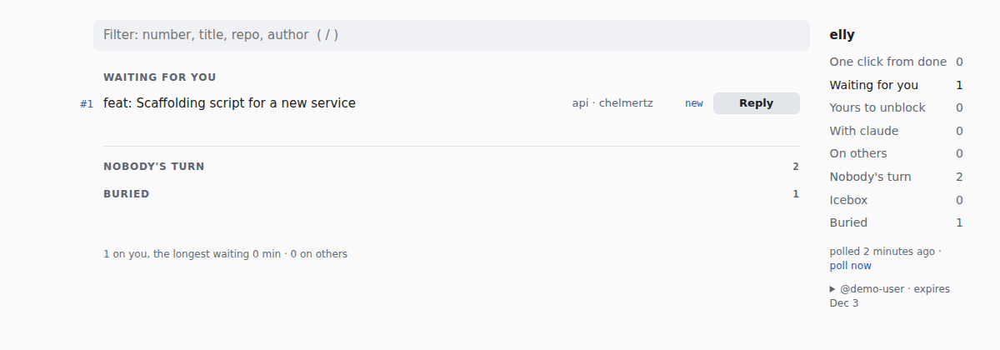
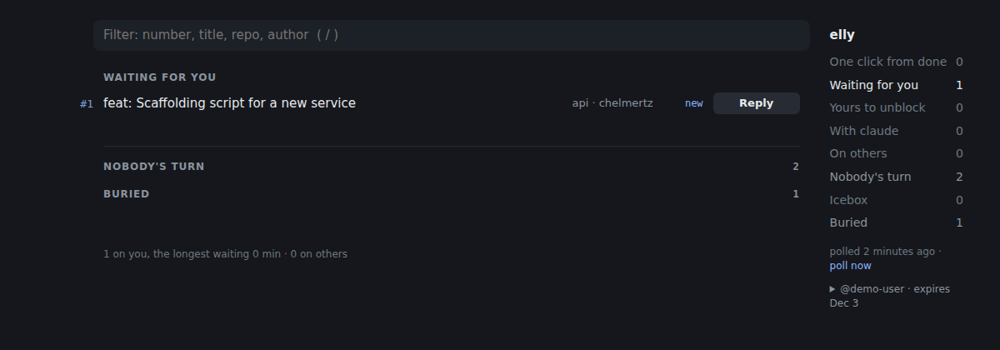
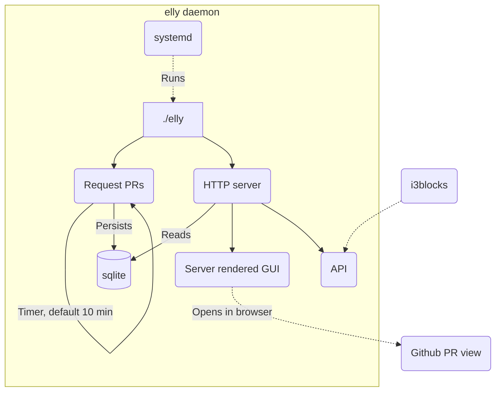

# elly

Github pull requests grouped by whose turn it is, via a web page & API.

Requires a Github PAT (personal access token). Set it under the account line in
the page's side menu, or pass it via the `GITHUB_PAT` environment variable. elly should be hosted
locally; see [What elly lets in](#what-elly-lets-in).







## The page

`/` groups PRs by whose turn it is rather than by score: one click from done, waiting for
you, yours to unblock, then folded groups for PRs on others, nobody's turn, the
icebox (untouched for two weeks) and buried. Points only order PRs inside a
group, so a high score never lifts a PR into a higher group; the rule is
`TurnOf` in `internal/points/turn.go`.

Each row shows one action and how long the PR has waited, counted from the
latest activity by someone other than you, or from its last update when there
is none. Clicking a row opens its history, why it is in its group, and its
state. `/` focuses a filter that matches number, title, repo and author as a
subsequence. Every row has an id, such as `/#pr-owner-repo-123`, and a link
to it highlights the row; a character in a name other than a letter or digit
is `_` and its hex code, so `my.repo` is `my_2erepo`. j and k (or the arrows) move between the rows outside
folded groups, enter opens the PR, o its details, b buries it, r polls now and
? lists the keys; none of them fires while typing in a field. A blue dot marks a PR that became your turn since
your previous visit, remembered in the browser only. The page follows the
system's light or dark theme. `/next`, where it lived beside the old page,
redirects to `/`.

With `-review-repos=owner/*,owner/repo` and `claude-review` in
`-annotation-schemes`, a review asked of you in one of those repos offers
Start instead of Review: a `claude-review://owner/repo/number` link that hands
the PR to claude-review, which then shows it under "With claude". Owner and
repo come from the PR URL and are refused when they are `.` or `..`; the
match is claude-review's own, so pass the same list as its `review_repos`.

`GET /api/v0/prs?turn=you` returns exactly the PRs in the groups on you, in
page order, so a status bar can show the same count as the page.
`?minPoints=N` filters by score instead, which counts a PR nobody has touched
for weeks for as long as it stays open.

## Desktop notifications

`elly -notify` sends a desktop notification through `notify-send` when a PR
gains a reason to act: your PR approved or with changes requested, someone
else commenting on your PR, a reply to your thread, or a review requested from
you. Each reason notifies once, until it goes away and comes back. The first
start records what is already there without notifying, and more than three in
one fetch arrive as one summary. Clicking a notification opens the page at
that PR's row; for a summary, at the highest-ranked PR in it.

`-work-owners=org1,org2` limits those owners to the reasons above. A PR whose
repo owner is not listed, such as an open-source contribution, notifies on
every change by someone else: a push, a comment, a review. With no
`-work-owners`, every owner gets that.

## Annotations

Another local tool can mark a PR as `handled`, `needs_you`, `stuck` or
`running`, with a note of up to 300 characters and up to four links; a note
or a link label holding a control or format character (a bidi override, a
zero-width one) is refused. `handled`
and `running` both say the user handed the PR to the tool, so both drop its
review-owed reasons from the score: `running` is a round in progress, which the
tool replaces with another state when it finishes. `needs_you` counts the PR
whatever it scored, and wins over `handled` and `running`. `stuck` counts like
`needs_you` and says nothing but the user will move the PR; the page marks its
row with an amber edge. On the page, a `handled` or `running` PR from
`claude-review` sits in the folded "With claude" group, and the note of a
`needs_you` or `stuck` annotation shows under its row. No annotation sends a
desktop notification.
Annotations expire (1 minute to 24 hours after writing), so a tool that stops
running stops hiding PRs.

```
PUT    /api/v0/prs/{base64 PR url}/annotations/{source}
       {"state":"needs_you","note":"…","links":[{"label":"…","url":"…"}],"expiresAt":"<RFC 3339>"}
DELETE /api/v0/prs/{base64 PR url}/annotations/{source}
```

The id is the PR URL in base64, padded, in either the standard or the
URL-safe alphabet; the page's own links use URL-safe, since a standard id can
hold `/`. Writes need `Authorization: Bearer <token>`, where the token is in
`$XDG_RUNTIME_DIR/elly/annotation-token` (or `-annotation-token-file`),
readable only by the user and new on every start. Links must be https, or use
a scheme named in `-annotation-schemes`; elly shows a custom-scheme link's
last path segment beside its label. A row's one action follows an annotation
link only when the link names that PR: its GitHub page (or a sub-path or
fragment of it), or a `claude-review://owner/repo/number` link. Every other
link stays in the row's details. A PR whose URL is not a GitHub PR URL gets no
link at all. `GET /api/v0/prs` returns each PR's live annotations.

## What elly lets in

elly listens on localhost, where every web page the browser has open can send
it requests. It answers only these:

- **Host** must be a loopback name (`localhost`, `127.0.0.1`, `[::1]`) on the
  listen port, the `-url` host itself when it is not a wildcard, or one of
  `-allowed-hosts` (comma-separated, matched as the Host header carries it,
  e.g. `elly.example` behind a reverse proxy). A wildcard bind such as
  `0.0.0.0:9876` gets the same check, so a site that points its own name at
  this machine (DNS rebinding) is refused everywhere.
- **A write** (anything but GET, HEAD and OPTIONS) is refused when its
  `Origin` is not `http://` on one of those hosts (`https://` passes only for
  an `-allowed-hosts` name, where a proxy may terminate TLS), or when its
  `Sec-Fetch-Site` is present and not `same-origin` or `none`. Another
  localhost port counts as another site. curl and scripts send neither header
  and pass.
- **A read** (GET or HEAD) whose `Sec-Fetch-Site` is `cross-site` or
  `same-site` is refused unless its `Sec-Fetch-Mode` is `navigate`: a link
  clicked elsewhere opens the page, a script, image or style sheet on another
  site or port cannot reach in. A typed URL or a bookmark sends `none`, and
  curl and scripts send neither header.
- **A write with a body** must say `Content-Type: application/json`, which a
  cross-site form cannot send without a preflight elly never answers. A
  request with `Authorization: Bearer …` is exempt, since a browser cannot
  add that cross-site without a preflight either.
- **A slow client** cannot hold a connection: headers must arrive within 5
  s, the request within 15 s, the answer is written within 30 s (5 minutes
  for checking a pasted token), and an idle connection closes after a
  minute. No body is read past 1 MiB.
- **Every response elly's handlers write**, refusals and 404s included,
  forbids framing
  (`frame-ancestors 'none'`, `X-Frame-Options: DENY`), so no other site can
  lay a decoy over a page and take the user's click, and sends `nosniff`,
  `Cross-Origin-Resource-Policy: same-origin` and a CSP of `default-src
  'none'` that runs only the page's own script, by its hash, and connects
  only to elly. Go's HTTP server answers a few requests before any handler
  sees them (`OPTIONS *`, and requests it cannot parse), and those carry
  none.

## The token

Set it on the page (`PUT /api/v0/config/pat`, `{"token":"…"}`) or through
`GITHUB_PAT`. elly checks a pasted token with GitHub before storing it, one
at a time (a second PUT meanwhile gets 429), and answers 400 "GitHub refused
the token" only when GitHub answers 401 (bad credentials). Anything else, a
403 or 429 rate limit, a 5xx or a page that is not JSON included, is 502
"could not reach GitHub, try again". The same holds on start: a stored token
is deleted only on a 401, and kept, with a warning in the log, on anything
else. GitHub's own error text goes to the log only, and the token is never
logged.
Clearing it (`DELETE /api/v0/config/pat`) stops polling until a new one is
set and deletes the stored PRs, so nothing goes on being served as current.
A clear that lands while a pasted token is being checked wins: that PUT
stores nothing and answers 409.
When GitHub rate-limits the poll, elly waits until the time GitHub names, at
most an hour; setting a token lifts the wait.
A token for another GitHub login than the previous one first deletes the
stored PRs, buries, annotations, notification history and org tokens, and a
poll still running with the old token stores nothing. A replaced or cleared
token is deleted, not kept inactive, and the database files are made
readable by the user only on start.

### Org tokens

A fine-grained token covers one resource owner, and some orgs take nothing
else. Each such org gets its own token beside the main one, on the page or
with `PUT /api/v0/config/pat/{owner}` (`{"token":"github_pat_…"}`) and
`DELETE /api/v0/config/pat/{owner}`. It must be fine-grained, made by the
main token's login, and see at least one of the owner's private
repositories: a token still waiting for the org's approval, or whose
resource owner is another account, answers every search with nothing, so
elly refuses it rather than show an empty org.

Every poll asks each org token for its owner's PRs and keeps only those,
after checking it still reaches the owner. The main token answers every other
owner. When an org token fails, the page and `GET /api/v0/config/status`
(`degradations[].owner`, `owner_tokens`) say so, without GitHub's text:

- refused (401) or lost access: the org's PRs leave the list at once, and
  the org is not polled again until a new token is pasted;
- rate limited, a 5xx or the network: its PRs stay as of the last good poll
  for up to an hour, then leave the list until a poll succeeds. A rate limit
  holds that org's polls back until GitHub's time, not the main token's.

Two things are accepted rather than defended against:

- The token routes need no token of their own: any process running as the
  user can swap or clear the PAT, as the page has to. No route ever returns
  it.
- A localhost port is open to every account on the machine. elly assumes a
  single-user host.

## PAT Oauth permissions

Two token classes work, and they differ in exactly one thing: whether elly can
name a failing Github Actions job.

### Fine-grained (recommended, read-only)

A **fine-grained** token (`github_pat_…`, created at
<https://github.com/settings/personal-access-tokens>) with these _repository_
permissions:

- commit status (read only)
- contents (read only)
- metadata (read only)
- pull requests (read only)

Also:

- allow the token access to "all repositories"
- adjust the "resource owner" to your personal or your workplace's organisation
- set a proper expiration date

**A fine-grained token cannot name a failing Github Actions job.** Github
restricts the _checks_ permission to Github Apps and does not offer it in the
fine-grained token UI at all, so there is nothing to grant. A pull request's
checks arrive as two types: Github Actions jobs are `CheckRun` and need
_checks_, while everything reported from outside Github - buildkite, jenkins,
sonarcloud - is `StatusContext` and is covered by _commit status_. The overall
red/green verdict is an aggregate Github computes for you and stays correct
either way; what disappears is the name of the Actions job that failed, and it
disappears silently, as nulls rather than as an error. Elly notices and says so
on its own page rather than showing you an empty list.

### Classic (names the Actions jobs, much broader)

A **classic** token (`ghp_…`, <https://github.com/settings/tokens>) with the
`repo` scope reads `CheckRun` and so gets the names. The cost is that `repo` is
read _and write_ on every repository you can reach, where the fine-grained
token above is read-only on four things. Authorise it for any SSO organisation
you need, and note that an organisation can forbid classic tokens outright.

Pick the fine-grained one unless the names of failing Actions jobs are worth
that blast radius.

## Installation


### Go package

```shell
go install github.com/chelmertz/elly@latest
```

will fetch you the latest binary. See contrib/elly.service for a systemd
example of managing the service.

### Docker

```shell { name=docker }
docker run -d \
  --name elly \
  --restart unless-stopped \
  -v elly-data:/data \
  -p 127.0.0.1:9876:9876 \
  ghcr.io/chelmertz/elly:latest
```

Publish the port on `127.0.0.1`, as above: elly inside the container binds
every interface, and `-p 9876:9876` would offer the token-backed API to the
whole network. Requests then arrive as `localhost:9876`, which elly answers.
Published on another host port, say `-p 127.0.0.1:8080:9876`, the Host is
`localhost:8080`; pass `-allowed-hosts localhost:8080` after the image name.

If you have `gh` CLI installed and authenticated, you can use `$(gh auth
token)` instead of a PAT you stashed away somewhere:

This creates a named volume `elly-data` for the SQLite database (Docker manages it automatically).

The `--restart unless-stopped` flag ensures elly starts automatically on boot.

**Useful commands:**

```shell
docker logs -f elly                             # View logs
docker stop elly                                # Stop
docker rm elly                                  # Remove
docker pull ghcr.io/chelmertz/elly:latest       # Update image
```

### Nix

Run directly: `nix run github:chelmertz/elly`

Or, install permanently:

- Add the flake to your system configuration
- Or: `nix profile install github:chelmertz/elly`

## Developing

`make test` runs the unit and property tests (rapid). `make props-long` runs
the property tests with 10000 cases each and `make mutate` runs gremlins,
failing when test efficacy or mutant coverage drops to the thresholds in
`.gremlins.yaml`; both are slow, so `.github/workflows/slow-tests.yml` runs
them daily instead of on every push. One property test drives random requests at the real
handler with seeded PRs and holds the rules in [What elly lets in](#what-elly-lets-in):
no 5xx, the base headers on every response, no GET that changes stored state,
and no cross-site or rebound request that succeeds.

`-github-api http://127.0.0.1:<port>` points a throwaway elly (with its own
`-db`, `-url` and `-annotation-token-file`) at a stub of GitHub's GraphQL
API, so it polls and serves seeded PRs. It takes GitHub's API or a loopback
address only, since elly sends the stored token there.

See [dev.md](dev.md) for some useful commands during development.

## Design decisions

See [decisions/](decisions/) for ADRs.
